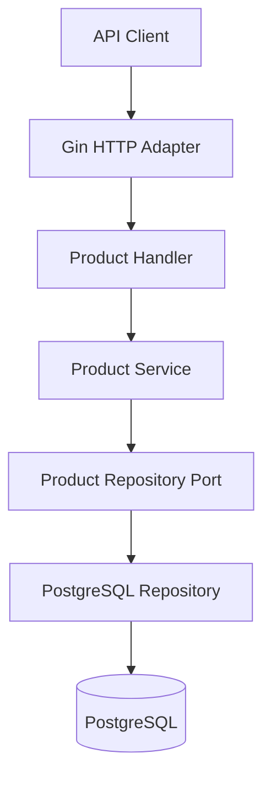

# StockFlow — Inventory Management API

A RESTful inventory management API built with **Go, Gin, and PostgreSQL**. StockFlow provides product management, inventory updates, searchable and paginated product listings, and safeguards against invalid stock quantities.

Built as a backend portfolio project, StockFlow demonstrates practical REST API development, lightweight hexagonal architecture, database migrations, automated testing, and Docker-based deployment.

## Features

- **Product management:** Create, retrieve, update, and delete products.
- **Inventory management:** Update stock quantities while preventing negative inventory.
- **Product search:** Find products through supported search filters.
- **Pagination:** Retrieve products in manageable pages with pagination metadata.
- **Soft deletion:** Mark products as deleted without immediately removing their database records.
- **Input validation:** Validate incoming requests and return structured error responses.
- **Consistent API responses:** Use a consistent JSON response format.
- **PostgreSQL integration:** Persist product data using `pgx`.
- **Database migrations:** Manage schema changes through versioned SQL migrations.
- **Automated tests:** Test business logic, query building, update behavior, and other application components.
- **Docker support:** Run the application and its dependencies using Docker Compose.

## Tech Stack

| Technology     | Purpose                                  |
| -------------- | ---------------------------------------- |
| Go             | Backend language                         |
| Gin            | HTTP routing and middleware              |
| PostgreSQL     | Relational database                      |
| pgx            | PostgreSQL driver and connection pooling |
| Docker         | Application containerization             |
| Docker Compose | Local multi-container development        |
| SQL migrations | Database schema versioning               |
| Go testing     | Unit and integration testing             |

## Architecture

StockFlow follows a lightweight **Hexagonal Architecture** that separates business logic from external systems such as HTTP and PostgreSQL.



### Architectural layers

- **HTTP adapter:** Receives requests, validates input, and translates application results into HTTP responses.
- **Service layer:** Implements product management and inventory business rules.
- **Repository port:** Defines the data-access operations required by the service.
- **PostgreSQL adapter:** Implements repository operations using `pgx`.
- **Domain layer:** Contains core product models, update behavior, filters, and application errors.

This structure keeps business rules independent of HTTP routing and database implementation details, making the application easier to test and maintain.

## API Endpoints

The API routes are prefixed with `/api/v1`, except where indicated.

| Method | Endpoint               | Description                                     |
| ------ | ---------------------- | ----------------------------------------------- |
| GET    | `/api/v1/healthz`      | Health check                                    |
| POST   | `/api/v1/products`     | Create a product                                |
| GET    | `/api/v1/products`     | List, search, and paginate products             |
| GET    | `/api/v1/products/:id` | Retrieve a product by ID                        |
| PATCH  | `/api/v1/products/:id` | Update product fields, including stock quantity |
| DELETE | `/api/v1/products/:id` | Soft-delete a product                           |

> **Note:** The deletion route shown here is the intended RESTful route. Ensure the Gin router uses `DELETE /api/v1/products/:id` rather than the previous `PATCH /api/v1/products/remove/:id` route before relying on this documentation.

Stock adjustments are currently handled through product updates. A dedicated `/adjustments` endpoint should only be documented once it has been implemented and registered.

## Example: Create a Product

```http
POST /api/v1/products
Content-Type: application/json
```

Example request body (adjust fields to match the actual DTO):

```json
{
  "name": "Mechanical Keyboard",
  "description": "RGB mechanical keyboard with blue switches",
  "price_minor": 45000,
  "stock_quantity": 25
}
```

`price_minor` represents the price in minor currency units. For example, if the application's currency is GHS, `45000` represents GH₵450.00. Confirm the configured currency and validation rules before using this as a production example.

## Example: List Products

```http
GET /api/v1/products?page=1&per_page=20
```

The list endpoint returns products alongside pagination metadata. The exact search and pagination query parameters depend on the implemented filters.

Example response shape:

```json
{
  "items": [],
  "page": 1,
  "per_page": 20,
  "total": 0,
  "total_pages": 0
}
```

## Getting Started

### Prerequisites

- Go (version specified by `go.mod`)
- Docker
- Docker Compose

### 1. Clone the repository

```bash
git clone https://github.com/joshua-takyi/stockflow-api.git
cd stockflow-api
```

### 2. Configure environment variables

Create your local environment file using `.env.example` as a reference.

```bash
cp .env.example .env
```

Set the database connection details and any other required configuration according to the application's configuration loader.

**Never commit `.env` files containing secrets.** Keep `.env.example` limited to variable names and safe example values.

### 3. Start the application

```bash
docker compose up --build -d
```

### 4. Check container status

```bash
docker compose ps
```

### 5. Check the health endpoint

```bash
curl http://localhost:8080/api/v1/healthz
```

The port and endpoint should match your local configuration and registered routes.

### 6. Stop the application

```bash
docker compose down
```

Database persistence depends on the volumes configured in `docker-compose.yml`. Avoid deleting volumes unless you intentionally want to remove local database data.

## Database Migrations

StockFlow uses versioned SQL migrations to manage database schema changes.

Migration files are located in:

```text
internal/adapters/postgres/migrations/
```

Each migration has an `up` file for applying a change and a `down` file for reversing it.

Use the migration command or startup process configured by the project. Before deploying to production, verify that migrations are applied to the intended database and that the process is safe to run during deployment.

## Running Tests

Run the complete test suite:

```bash
go test ./...
```

Run tests with the race detector:

```bash
go test -race ./...
```

Run static analysis:

```bash
go vet ./...
```

Tests that require PostgreSQL must have access to a correctly configured test database.

## Deployment

StockFlow is designed to run in Docker and can be deployed to a container hosting platform such as Render.

A typical production setup consists of:

1. A Docker-based web service running the Go API.
2. A managed PostgreSQL database.
3. Environment variables configured through the hosting platform.
4. Database migrations applied to the production database.
5. A deployed health endpoint used to verify the service.

Keep production database credentials and other secrets out of source control. Use the database's internal connection URL when the hosting provider supports it and the API and database are appropriately colocated.

**Live API:** Add your deployed URL after deployment is complete.

## Project Status

StockFlow is a backend portfolio project focused on:

- RESTful API design
- Go application architecture
- PostgreSQL and database migrations
- Inventory validation and data integrity
- Search and pagination
- Automated testing
- Docker-based development and deployment

The next milestone is production deployment, followed by documenting the live API URL and verifying the documented setup from a clean environment.
