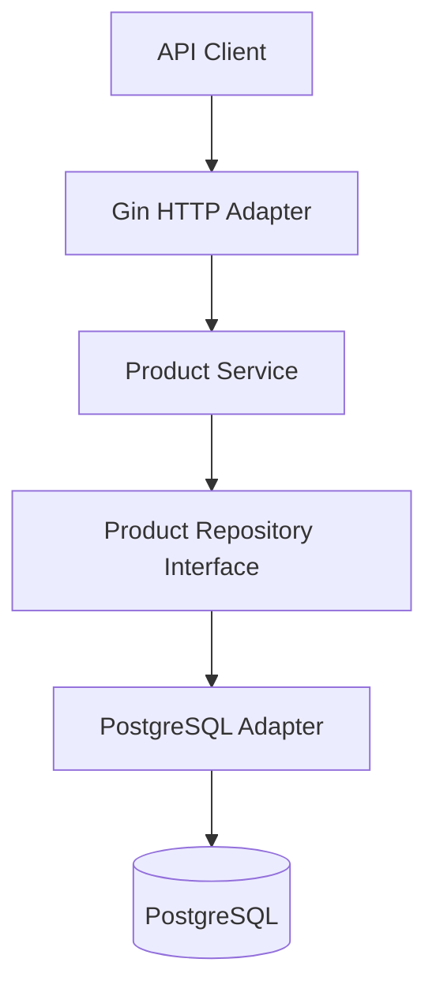

# StockFlow API

A RESTful inventory management API built with Go and PostgreSQL. StockFlow provides product management, stock adjustments, and basic inventory safeguards.

## Features

- Product CRUD operations
- Product search and pagination
- Stock increases and decreases
- Prevention of negative stock quantities
- Consistent JSON responses and error handling
- Database migrations
- Docker-based development and deployment
- Unit and integration testing

## Tech Stack

| Technology     | Purpose                                  |
| -------------- | ---------------------------------------- |
| Go             | Backend language                         |
| Gin            | HTTP routing and middleware              |
| PostgreSQL     | Relational database                      |
| pgx            | PostgreSQL driver and connection pooling |
| Docker         | Containerization                         |
| Docker Compose | Local multi-container setup              |
| SQL migrations | Database schema management               |
| Go testing     | Automated tests                          |

## Architecture

StockFlow follows a lightweight **Hexagonal Architecture** to separate business logic from HTTP and database implementation details.



- **HTTP adapter:** Handles requests, validation, and HTTP responses.
- **Service:** Implements product and inventory business rules.
- **Repository interface:** Defines how the service accesses product data.
- **PostgreSQL adapter:** Implements database operations using pgx.

## API Endpoints

| Method | Endpoint                           | Description              |
| ------ | ---------------------------------- | ------------------------ |
| GET    | `/health`                          | Health check             |
| POST   | `/api/v1/products`                 | Create a product         |
| GET    | `/api/v1/products`                 | List and search products |
| GET    | `/api/v1/products/:id`             | Get a product            |
| PATCH  | `/api/v1/products/:id`             | Update a product         |
| DELETE | `/api/v1/products/:id`             | Delete a product         |
| POST   | `/api/v1/products/:id/adjustments` | Adjust stock             |

## Getting Started

### Prerequisites

- Go
- Docker
- Docker Compose

### Run with Docker

1. Clone the repository:

   ```bash
   git clone https://github.com/joshua-takyi/stockflow-api.git
   cd stockflow-api
   ```

2. Configure the environment variables using `.env.example`.

3. Start the application:

   ```bash
   docker compose up --build -d
   ```

4. Check the running containers:

   ```bash
   docker compose ps
   ```

5. Test the health endpoint:

   ```bash
   curl http://localhost:8080/health
   ```

> Database migrations and environment variable names must match the actual project implementation.

## Running Tests

Run all tests:

```bash
go test ./...
```

Run tests with the race detector:

```bash
go test -race ./...
```

## Project Status

StockFlow is a portfolio project focused on clean backend architecture, REST API development, PostgreSQL integration, testing, and containerization.
